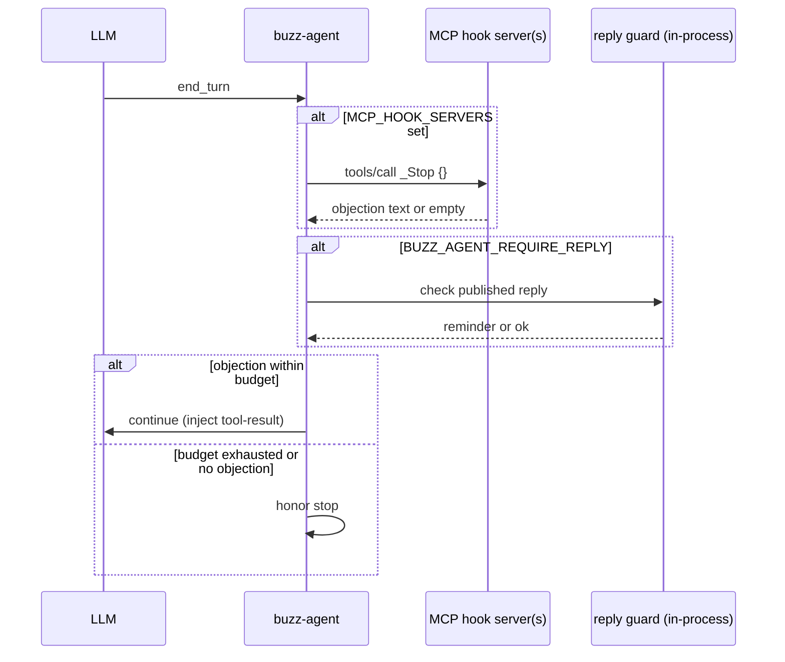

# Contract: Formal gates (Buzz Verify stage)

**Spec**: [011-buzz-durable-agent-platform](../spec.md)

**Status**: S04 complete — Buzz hook points, px-validate flow, inherited Charter M invariants documented.

**Upstream reference**: [010 formal-gates.md](../../../06-pipelines/specs/010-durable-agent-platform/contracts/formal-gates.md)

**Related**: [mcp-registry.md](./mcp-registry.md) § px-validate, [MCP_DRIVEN_HOOKS.md](../../../docs/MCP_DRIVEN_HOOKS.md)

---

## Purpose

Define how Buzz agents **Verify** work before stopping, after compaction, and (future) before validated ontology writes. Buzz Verify combines:

1. **Lifecycle hooks** — advisory MCP gates at `_Stop` / `_PostCompact` (and future `_FormalGate`)
2. **px-validate MCP** — LinkML/registry validation for memory and action proposals
3. **Upstream formal stack** — Quint/P/TLA+/Lean in `06-pipelines/formal/` (operator CI, not desktop hot path)
4. **cloud-agent tool_io_guard** — Quint I1–I8 on Mastra MCP tool pre/post

Desktop **does not** run `formal/run.sh` inside Tauri. Operators and upstream agent-brain run formal batches; buzz-agent enforces runtime Verify via hooks + optional px-validate tools.

---

## Verify layer stack

| Layer | Runner | Buzz touchpoint | Blocks spend? |
|-------|--------|-----------------|---------------|
| **A — MCP hooks** | `buzz-agent` at lifecycle points | `MCP_HOOK_SERVERS` allowlist | `_Stop` objection only (advisory) |
| **B — px-validate MCP** | External MCP server | LLM tools + hook-adjacent writes | `validate_proposal` reject → no validated write |
| **C — Upstream formal** | `06-pipelines/formal/run.sh` | Operator CI; Temporal activity (design) | Job `failed`; Do skipped |
| **D — tool_io_guard** | cloud-agent Mastra MCP | Remote Do sessions | Tool call rejected pre/post |

Full registry: [mcp-registry.md](./mcp-registry.md).

---

## Buzz hook points

Convention: tools whose bare name starts with `_` are **lifecycle hooks**. Filtered from LLM `tools/list`; invoked only by `buzz-agent`. See [MCP_DRIVEN_HOOKS.md](../../../docs/MCP_DRIVEN_HOOKS.md).

### Implemented hooks

| Hook | When | Input | Output semantics | Code owner |
|------|------|-------|------------------|------------|
| `_Stop` | LLM signals `end_turn`, before honor | `{}` | Non-empty text = objection (continue turn); empty = allow stop | `crates/buzz-agent/` |
| `_PostCompact` | After context compaction, before next prompt | `{}` | Non-empty → injected as tool-result (JSON-encoded, lower trust) | `crates/buzz-agent/` |

### Future hook (S04+ design — not implemented)

| Hook | When | Intended use |
|------|------|----------------|
| `_FormalGate` | Before `_Stop` or before validated relay write | Delegate to px-validate `validate_proposal`; return objection text on reject |

`_FormalGate` is **not** registered in buzz-agent yet. v1 pattern: operator implements `_Stop` on a px-validate wrapper MCP server that calls `validate_proposal` internally and returns validation errors as objection text.

### Agent sovereignty (fail-open vs fail-closed)

| Constraint | Env | Behavior |
|------------|-----|----------|
| Hooks off by default | `MCP_HOOK_SERVERS` unset | No hook calls |
| Hook timeout | `BUZZ_AGENT_HOOK_TIMEOUT_MS` (default 2500) | Timeout = no objection (fail-open for liveness) |
| Second consecutive timeout | same | May kill MCP server |
| Stop rejection budget | `BUZZ_AGENT_STOP_MAX_REJECTIONS` (default 3) | After exhaustion, agent stops regardless |
| Reply guard (in-process) | `BUZZ_AGENT_REQUIRE_REPLY=1` | Shares `_Stop` budget; not an MCP hook |

**px-validate** and **upstream formal** are **fail-closed** (reject blocks writes / fails job). Hooks are **advisory fail-open** except when operator configures objection text.

### In-process reply guard (not a hook)

`BUZZ_AGENT_REQUIRE_REPLY=1` triggers an in-process reminder at the `_Stop` gate (`server: "buzz-agent"` in hook telemetry). No MCP server required. Documented in [buzz-agent README](../../../crates/buzz-agent/README.md#reply-guard).

---

## `_Stop` gate sequence



---

## px-validate MCP (Layer B)

**Product path**: `Brightforest/projects/tools/px-validate/formal/`

**Cursor namespace**: `user-px-validate` (stdio MCP when configured in operator environment)

### Verify-critical tools

| Tool | Role | Fail-closed effect |
|------|------|-------------------|
| `validate_proposal` | LinkML + optional approved-class registry check | Reject → block downstream validated write |
| `write_validated_memory` | Persist memory after validation pass | Must not succeed if proposal invalid |
| `write_validated_action` | Persist action after validation pass | Same |
| `run_validation_suite` | Batch formal checks | Operator gate; not per-turn default |

Supporting tools (retrieval, ontology trace, etc.) are **not** Verify gates — see [mcp-registry.md](./mcp-registry.md).

### `validate_proposal` flow (pre-write)

```
Agent or hook wrapper
  → validate_proposal { data, class_name, check_registry? }
  → { ok: true }  → allow write_validated_memory / relay publish
  → { ok: false, errors: [...] }  → fail-closed; surface errors to LLM or _Stop objection
```

**Required args**: `data` (object), `class_name` (string). Optional `check_registry: true` for approved-class enforcement.

### Pre/post placement

| Stage | Mechanism | Example |
|-------|-----------|---------|
| **Pre** (before write) | LLM calls `validate_proposal` before `write_validated_*` | Ontology CRUD bot |
| **Pre** (before stop) | `_Stop` hook server calls `validate_proposal` on pending draft | Todo + schema enforcement |
| **Post** (batch) | Operator runs `run_validation_suite` | CI / release gate |
| **Post** (upstream) | `formal/run.sh` after Think, before Do | agent-brain activity (design) |

Buzz relay events that carry **validated memory** must fail closed when px-validate rejects — no silent downgrade to unvalidated publish.

---

## Platform invariants (Charter M — inherited)

Buzz inherits upstream Charter M claims. Buzz does not re-prove them in desktop; operators run upstream smoke + formal.

| ID | Upstream tool | Claim | Buzz relevance |
|----|---------------|-------|----------------|
| **M-T1** | Quint `PlatformConductor.qnt` | Baseten submit follows Temporal workflow start | Upstream conductor; Buzz displays `job_id` when passed in env (S05) |
| **M-T2** | P `PlatformWorkflow.p` | Sandbox destroyed after Do completes | Remote Do via [daytona-do.md](./daytona-do.md) |
| **M-B1** | Quint (chain specialty) | Specialty required before chain HTTP | No desktop chain HTTP ([baseten-think.md](./baseten-think.md)) |
| **M-F1** | Lean / Brain filter | Filter URL rejects unknown params | Upstream brain UI (008); N/A desktop hot path |

### Mapping to existing invariants

| Platform | Existing | Notes |
|----------|----------|-------|
| M-B1 | I26 | No SQL from chain ingest |
| M-F1 | 008 Brain filter | `formal/quint/BrainFilter.qnt` |
| Ontology I1–I36 | `formal/run.sh` | Unchanged for ontology slices |
| tool_io_guard I1–I8 | cloud-agent Quint | `config/verification/` |

---

## End-to-end Verify in platform dispatch

From [mcp-registry.md](./mcp-registry.md) workflow sequence:

| Phase | Verify touchpoint |
|-------|-------------------|
| Think | Optional upstream formal after chain (Layer C) |
| Do | `tool_io_guard` pre/post (Layer D) |
| **Verify** | `_Stop` / `_PostCompact` hooks; px-validate on writes |
| Durability | Failed Verify → job/run status failed; no silent retry of invalid writes |

---

## Fail-closed rules (Buzz + upstream)

1. **`validate_proposal` reject** → no `write_validated_memory` / `write_validated_action`; relay must not publish as validated
2. **Hook objection within budget** → agent continues turn (advisory; not a hard platform fail)
3. **Upstream formal failure** → job status `failed`; Do skipped; no Surreal ontology write (upstream)
4. **Playwright green alone** does not satisfy formal/construct claims (formal-gate persona rule)
5. **Lean4 stage** in px-validate pipeline: required when proofs touched (`lake build`)
6. **Hidden hooks** → LLM direct call to `_Stop` / `_PostCompact` rejected as unknown tool (defense in depth)

---

## Configuration (operator)

| Env | Default | Surface |
|-----|---------|---------|
| `MCP_HOOK_SERVERS` | unset | buzz-agent — `*` or comma-separated server names |
| `BUZZ_AGENT_HOOK_TIMEOUT_MS` | 2500 | Per-hook timeout |
| `BUZZ_AGENT_STOP_MAX_REJECTIONS` | 3 | `_Stop` budget per prompt (0 = disable hooks + reply guard budget) |
| `BUZZ_AGENT_REQUIRE_REPLY` | unset | In-process reply guard at `_Stop` |

px-validate MCP: attach via agent harness `mcp.json` (see registry). **Never** commit API keys or Surreal credentials.

---

## Gate commands (verification order)

```bash
# 1. Platform smoke (subset, no cloud spend) — S04 manifest gate
bash ../../06-pipelines/specs/010-durable-agent-platform/scripts/smoke-platform-loop.sh

# 2. Buzz hook regression tests (hermetic fake MCP)
cd crates/buzz-agent && cargo test hook_

# 3. Full upstream formal stack
bash ../../06-pipelines/formal/run.sh

# 4. px-validate (when MCP available)
# validate_proposal / run_validation_suite via MCP client

# 5. cloud-agent tool guard
cd ../cloud-agent && npm run smoke:formal
```

---

## Code anchors

| Component | Path |
|-----------|------|
| Hook convention doc | `docs/MCP_DRIVEN_HOOKS.md` |
| Hook implementation | `crates/buzz-agent/src/` (lifecycle gate) |
| Hook regression tests | `crates/buzz-agent/tests/regressions.rs` |
| Permission boundary (hooks bypass ask) | `crates/buzz-agent/tests/permission_boundary.rs` |
| MCP registry | `specs/011-buzz-durable-agent-platform/contracts/mcp-registry.md` |
| Upstream formal models | `../../06-pipelines/formal/PlatformConductor.qnt`, `formal/p-models/PlatformWorkflow.p` |

---

## Open items (post-S04 code)

- [ ] Implement `_FormalGate` hook point in buzz-agent (optional — wrapper `_Stop` suffices for v1)
- [ ] Example px-validate `_Stop` hook server (todo + schema enforcement)
- [ ] buzz-agent integration test with mock px-validate MCP (see `.gsd/evidence/20260908-buzz-s04.md` plan)
- [ ] Buzz CI: `cargo test hook_` + smoke-platform-loop on schedule
- [ ] Close **B-formal-hooks** wire gate in `.gsd/gaps/tracking.md`
