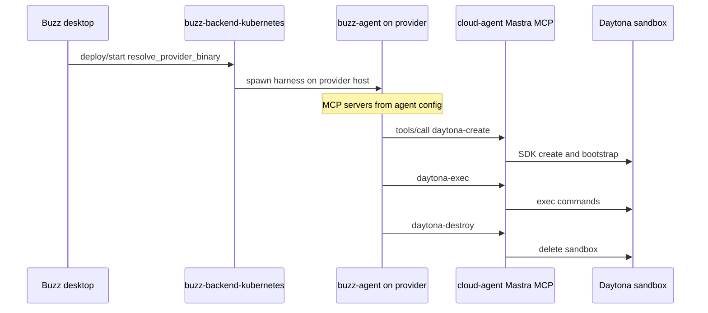
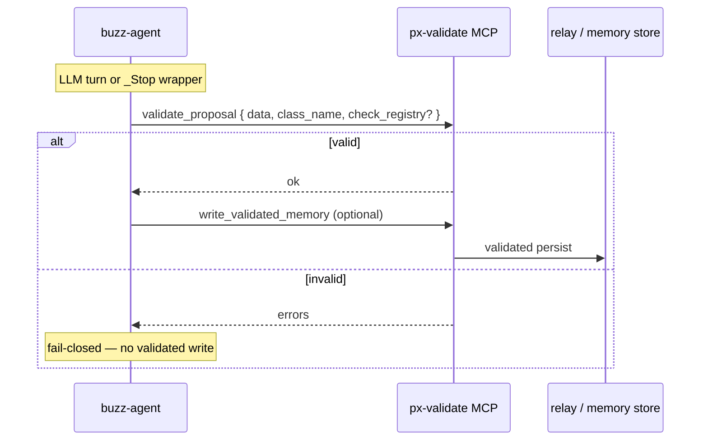
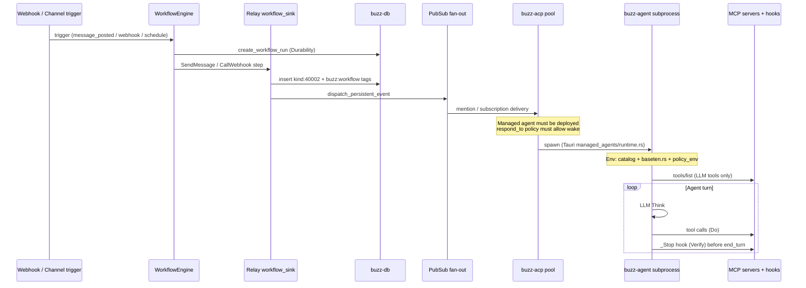

# Contract: MCP registry (Buzz agent platform)

**Spec**: [011-buzz-durable-agent-platform](../spec.md)

**Status**: S04 complete — px-validate registration + Think/Do/Verify paths documented.

**Upstream reference**: [010 agent-platform.md](../../../06-pipelines/specs/010-durable-agent-platform/contracts/agent-platform.md)

**Example workflow**: [examples/platform-dispatch.workflow.yaml](../examples/platform-dispatch.workflow.yaml)

## Purpose

Single registry of MCP servers available to `buzz-agent` and operator tooling for the durable agent platform. Distinguishes:

1. **LLM-visible tools** — passed to model `tools/list`
2. **Lifecycle hooks** — `_`-prefixed; filtered from LLM; invoked by agent (`MCP_HOOK_SERVERS`)
3. **Operator-only** — desktop/Tauri; not in agent subprocess

## Buzz-native servers

| Server | Package | Transport | Role |
|--------|---------|-----------|------|
| `buzz-dev-mcp` | `crates/buzz-dev-mcp` | stdio (ACP harness) | Shell + file edit for local dev agents |
| *(configured)* | operator `mcp.json` / env | stdio/SSE | User-attached MCP servers |

## Platform servers (cross-repo — not bundled in Buzz)

| Server | Path | Tools (subset) | Buzz phase |
|--------|------|----------------|------------|
| `cloud-agent-mastra` | `../cloud-agent/` | `daytona-*`, `px_sandbox_*`, `tool_io_guard`, `sdlc-batch` | Do / Verify |
| `baseten-chain-mcp` | `../../baseten-chain-mcp/` | `validate_chain_spec`, `submit_chain_job`, `get_chain_job` | Think |
| `px-validate` | px-validate MCP | `validate_proposal`, `run_validation_suite` | Verify |

Launch Mastra MCP (operator):

```bash
cd ../cloud-agent
SANDBOX_PROVIDER=daytona bash scripts/run-mastra-mcp.sh
```

---

## Think path: inference vs governed chain (S03)

Buzz **Think** has two paths. Only Path A runs inside desktop spawn; Path B is upstream MCP.

| Path | Trigger | Implementation | MCP tools |
|------|---------|----------------|-----------|
| **A — Inference** | Operator picks Baseten provider in desktop | `managed_agents/baseten.rs` → `OPENAI_COMPAT_*` | *(none required)* |
| **B — Chain** | Platform specialty / `ChainExecutionSpec` | `baseten-chain-mcp` | `validate_chain_spec`, `submit_chain_job`, `get_chain_job` |

Full contract: [baseten-think.md](./baseten-think.md)

### When desktop uses Path A (`baseten.rs`)

- Managed agent spawn with `provider: baseten`
- Interactive LLM turns in channels (including workflow @mention wake from S01)
- Model sync / discovery against Baseten deployment URLs
- Any buzz-agent session where operator configured Baseten in Global Defaults or agent profile

Desktop applies env at spawn:

```
Tauri spawn → apply_baseten_env(provider=baseten) → buzz-agent (OpenAI-compat chat API)
```

**Never** calls portfolio `chain-nwxlx5wy` HTTP from Rust or TypeScript.

### When to use Path B (`submit_chain_job`)

- Grok persona `baseten-chain-operator` / 06-pipelines ontology-flow bots
- Specialties in `baseten-chain-ids.json` (`verify-gate-plan`, `ontology-action-draft`, …)
- Job payload includes or references `ChainExecutionSpec`
- Operator attaches **baseten-chain-mcp** to Cursor / fleet MCP config

**Mandatory order:**

```
validate_chain_spec(spec) → submit_chain_job(spec) → get_chain_job(id)
```

`validate_chain_spec` **must** pass before spend — fail-closed.

### Portfolio default

| Variable | Value |
|----------|-------|
| `BASETEN_CHAIN_PORTFOLIO_ID` | `nwxlx5wy` |
| Legacy chain | `6wgorv34` — deprecated for new platform jobs |

Registry: `../gpu-inference-stack/config/baseten-chain-ids.json`

### Combining Think with agent sessions

| Pattern | Think | Notes |
|---------|-------|-------|
| Desktop chat agent | Path A only | Default operator experience |
| Platform pack job | Path B → optional agent summary | Chain output ingested upstream; not desktop HTTP |
| Workflow wake + Baseten agent | Path A in agent | Dispatch S01; Think in buzz-agent subprocess |

Launch baseten-chain-mcp (operator — separate from cloud-agent):

```bash
cd ../../baseten-chain-mcp
# Follow package README / MCP stdio launcher for your environment
```

---

## `buzz-backend-*` provider → cloud-agent MCP handoff (S02)

Buzz **remote agents** run on PATH-discovered `buzz-backend-{id}` binaries (`managed_agents/backend.rs`). That path hosts the **agent process** on a provider cluster or workstation. **Platform-isolated Do** (Daytona sandboxes) still flows through **cloud-agent Mastra MCP** — the backend crate does not replace Daytona.

### Two execution planes

| Plane | Owner | Do executes on | MCP attach point |
|-------|-------|---------------|------------------|
| **Agent hosting** | Buzz desktop + `buzz-backend-*` | Provider pod/VM | Agent subprocess on provider |
| **Platform sandbox Do** | cloud-agent Mastra MCP | Daytona sandbox | Operator MCP client or agent MCP config |

### Handoff sequence (remote agent + platform Do)



### Operator wiring (v1 — manual)

1. Launch cloud-agent MCP on operator machine or sidecar reachable from provider network
2. Add MCP server to **remote agent definition** (same as local agent MCP list)
3. Ensure provider network egress to Daytona API + git clone targets
4. Set agent env via provider secret store — **never** commit secrets

### Desktop guarantees (S02)

| Guarantee | Implementation |
|-----------|----------------|
| Run-location warning | `agentAccessWarning.ts` — remote copy names server scope |
| Provider discovery only | `discover_provider_candidates()` — no arbitrary binary paths |
| No Daytona in Tauri | Do delegated per [daytona-do.md](./daytona-do.md) |
| relay-mesh | Shared compute provider; local spawn unless runOn selects backend |

### Future (post-S02 code)

- Provider deploy template injects `CLOUD_AGENT_MCP_*` endpoint env
- `buzz-backend-kubernetes` ConfigMap for MCP sidecar (gap `B-daytona-mcp` wire criteria)

Full Do contract: [daytona-do.md](./daytona-do.md).

---

## Hook allowlist (`MCP_HOOK_SERVERS`)

Per [docs/MCP_DRIVEN_HOOKS.md](../../../docs/MCP_DRIVEN_HOOKS.md):

| Env | Default | Description |
|-----|---------|-------------|
| `MCP_HOOK_SERVERS` | unset (hooks off) | `*` or comma-separated server names |
| `BUZZ_AGENT_HOOK_TIMEOUT_MS` | 2500 | Per-hook timeout |
| `BUZZ_AGENT_STOP_MAX_REJECTIONS` | 3 | `_Stop` budget per prompt |

### Registered hook tools (convention)

| Hook | Lifecycle point | Buzz owner |
|------|-----------------|------------|
| `_Stop` | Before `end_turn` | `buzz-agent` |
| `_PostCompact` | After compaction | `buzz-agent` |

Hook implementations live on **external** MCP servers — not in `buzz-dev-mcp` unless explicitly added.

---

## px-validate MCP registration (S04)

**Product**: `Brightforest/projects/tools/px-validate/`

**Verify phase**: Formal validation of ontology proposals before validated writes.

### Server identity

| Context | Name / namespace | Transport |
|---------|------------------|-----------|
| Cursor MCP | `user-px-validate` | stdio (operator `.cursor/mcp.json`) |
| Agent harness | operator-defined key in `mcp.json` | stdio recommended |
| Hook allowlist | same key as harness entry | set in `MCP_HOOK_SERVERS` if hooks exposed |

Align harness server **name** with `MCP_HOOK_SERVERS` when using px-validate-backed `_Stop` wrappers.

### Verify-critical tools (subset)

| Tool | LLM-visible? | Gate role |
|------|--------------|-----------|
| `validate_proposal` | yes | **Pre-write** — LinkML + optional registry |
| `write_validated_memory` | yes | Post-validation persist (fail-closed pair) |
| `write_validated_action` | yes | Post-validation persist (fail-closed pair) |
| `run_validation_suite` | yes (operator) | Batch CI gate |

Hooks (`_Stop`, `_PostCompact`) are **never** LLM-visible regardless of server.

### `validate_proposal` flow



**Mandatory order for validated content:**

```
validate_proposal → (pass) → write_validated_memory | write_validated_action
```

Reject from `validate_proposal` must block validated relay publish (constitution IX inherited).

### Example operator `mcp.json` fragment

```json
{
  "mcpServers": {
    "px-validate": {
      "command": "uv",
      "args": ["run", "px-validate-mcp"],
      "env": {
        "PX_VALIDATE_MODE": "local"
      }
    }
  }
}
```

Paths and launch command vary by install — follow px-validate package README. **Do not commit secrets** (Surreal, API keys, Weaviate) in repo configs.

### Combining px-validate with hooks

| Pattern | Config | Use when |
|---------|--------|----------|
| LLM tools only | px-validate in harness; hooks off | Agent calls `validate_proposal` explicitly |
| `_Stop` enforcement | Wrapper MCP or px-validate exposes `_Stop` | Block end_turn while schema/todos fail |
| `_PostCompact` reinject | Separate hook server | Restore todo state after compaction |

Future `_FormalGate` hook (see [formal-gates.md](./formal-gates.md)) may consolidate validate-before-stop; v1 uses `_Stop` wrapper.

Full Verify contract: [formal-gates.md](./formal-gates.md).

---

## Desktop agent MCP display

Agent profile shows MCP servers reported by running session (`desktop/src/features/agents/` rule 13). Platform registry does not inject synthetic MCP rows into profile UI.

---

## Workflow trigger → agent spawn sequence (S01)

Buzz replaces upstream Grok fleet **dispatch** with relay workflows + managed-agent spawn. Think/Do/Verify/Durability phases map to agent runtime — not separate Grok personas.

### Platform phase map

| Phase | Upstream persona | Buzz surface | When |
|-------|------------------|--------------|------|
| **Dispatch** | `bot-fleet-orchestrator` | `buzz-workflow` trigger + relay | Workflow fires |
| **Think** | `baseten-chain-operator` | `buzz-agent` LLM turn (+ optional upstream chain MCP) | Agent processes mention/instruction |
| **Do** | `daytona-sandbox-operator` | Agent MCP tools / remote backend | Tool calls in session |
| **Verify** | `formal-gate` | MCP hooks `_Stop` / `_PostCompact`, px-validate | Before stop / after compact |
| **Durability** | `temporal-conductor` | `workflow_run` row + upstream Temporal id (env) | Across retries / restarts |

### End-to-end sequence



### Step-by-step (code anchors)

#### 1. Trigger ingestion

| Trigger | Entry | Notes |
|---------|-------|-------|
| `message_posted` | `WorkflowEngine` event handler | Channel-scoped; optional evalexpr `filter` |
| `webhook` | `POST /hooks/{id}` | Body available as `trigger.body.*` in templates |
| `schedule` | Cron loop (60s tick) | `create_workflow_run` + scheduled claim |
| `reaction_added` / `diff_posted` | Same engine path | Less common for platform dispatch |

**Schema**: `crates/buzz-workflow/src/schema.rs` (`TriggerDef`, `WorkflowDef`)

#### 2. Workflow run persistence (Durability — partial)

- `WorkflowEngine` creates a `workflow_run` row before executing steps.
- Failed steps update run status; approval steps can suspend execution.
- Full cross-repo durability (Temporal `platform:{tenant}:{jobId}`) is **upstream** — pass id via webhook body or agent env (S05).

#### 3. Dispatch action — wake agent via mention

Primary pattern for S01: **`send_message` with `@AgentDisplayName`** in both:

1. Rendered message text (legacy `p` tags for feeds)
2. Stored step template (authority for `buzz:workflow-mention` tag)

Implementation: `crates/buzz-relay/src/workflow_sink.rs`

- Tags: `buzz:workflow`, `buzz:workflow-owner`, optional `buzz:workflow-mention`
- Anti-recursion: workflow-generated messages do not re-trigger workflows
- Mention authority: trigger cannot borrow workflow-owner authority for agents not named in the **stored** template

#### 4. Relay fan-out

After DB insert, `dispatch_persistent_event` publishes to subscribed clients and ACP harnesses.

#### 5. Managed agent spawn (Think prep)

Desktop path (operator deploys agent first):

| Stage | Component | File |
|-------|-----------|------|
| Config UI | Agent defaults / definition | `desktop/src/features/agents/` |
| Catalog projection | `deriveAgentConfigFieldModel` | `lib/agentConfigCore.ts` |
| Spawn | `managed_agents/runtime.rs` | Applies env layers |
| Baseten Think transport | `apply_baseten_env` | `managed_agents/baseten.rs` |
| ACP session | `buzz-acp` pool | Effort at spawn via `BUZZ_ACP_EFFORT_LEVEL` |

**Prerequisite**: Agent record exists, harness available, channel membership + `respond_to` policy admit the mention.

Manual spawn path: user clicks **Start** in desktop — same spawn pipeline without workflow.

#### 6. Agent runtime (Think → Do → Verify)

| Phase | Mechanism |
|-------|-----------|
| Think | `buzz-agent` LLM + provider env (`OPENAI_COMPAT_*` when Baseten) |
| Do | MCP tools from harness config (`buzz-dev-mcp` + operator servers); remote Do via provider backend (S02) |
| Verify | `MCP_HOOK_SERVERS` → `_Stop` / `_PostCompact`; optional px-validate tools |
| Durability | Session + relay events; upstream conductor for chain jobs |

#### 7. Optional upstream Think (chain specialty)

When job requires **portfolio chain** (not inline LLM):

```
Operator / upstream → baseten-chain-mcp submit_chain_job
  → Temporal baseten-chain queue
  → Result referenced in env or webhook receipt
```

Desktop **does not** call chain HTTP directly (constitution X.III).

### Dispatch alternatives

| Pattern | Use when |
|---------|----------|
| Workflow `@mention` | Channel agents, policy-gated wake (default S01) |
| Direct mention (user) | Interactive chat — same ACP path, no workflow |
| Webhook → `call_webhook` | Notify upstream conductor only; does not spawn agent |
| Desktop **Start** | Operator-initiated; no workflow required |
| `buzz-cli` + relay | Agent-first CLI; separate from workflow engine |

### Configuration checklist (operator)

1. Deploy managed agent with harness + provider (Global Defaults or per-agent)
2. Ensure agent is in target channel with valid `respond_to` policy
3. Save workflow YAML with `@ExactDisplayName` matching channel member name
4. (Optional) Set agent MCP servers for Do tools
5. (Optional) Set `MCP_HOOK_SERVERS` on agent env for Verify hooks
6. (Optional) Pass `job_id` / `conductor_url` in webhook POST body

### Example

See [examples/platform-dispatch.workflow.yaml](../examples/platform-dispatch.workflow.yaml).

---

## Forbidden

- Duplicating upstream chain HTTP in desktop for Think jobs
- Passing hook tools to LLM tool list
- Silent fallback when MCP server name in allowlist is missing (must log + treat as no objection for `_Stop` only per timeout rules)
- Workflow trigger rendering `@Agent` without matching stored template (no authority wake)

## Open items

- [x] Workflow dispatch sequence documented (S01)
- [x] Example workflow YAML (S01)
- [x] Canonical `mcp.json` example for platform operators (S04) — px-validate fragment
- [x] px-validate server name alignment (`user-px-validate` / harness key) (S04)
- [x] Remote backend MCP handoff documented (S02) — see § `buzz-backend-*` → cloud-agent MCP
- [ ] Provider deploy injects MCP endpoint env (code PR)
