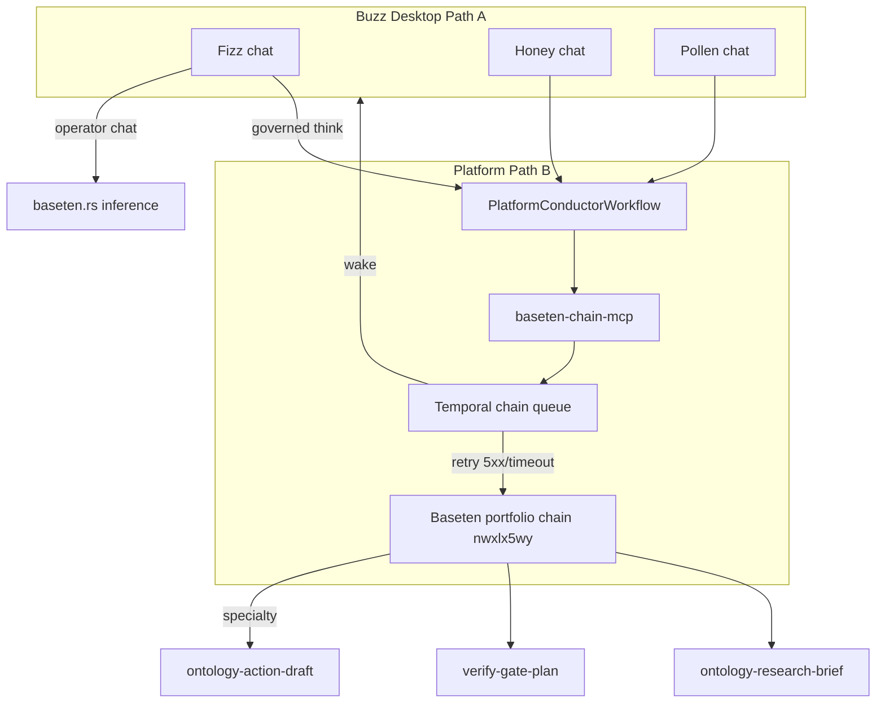

# Welcome Team Product Conversation — Ontology Chainlets + Temporal Durability

**Spec**: [011-buzz-durable-agent-platform](../spec.md)  
**Status**: Product design (v1)  
**Participants**: Fizz (lead), Honey (communicator), Pollen (researcher); **platform dev** — Chain, Tempo, Sandbox, Gate, E2E (continuation below)  
**Related contracts**: [baseten-think.md](../contracts/baseten-think.md), [durability-handoff.md](../contracts/durability-handoff.md), [formal-gates.md](../contracts/formal-gates.md)

---

## Product thesis

Each Welcome Team agent has a **dedicated ontology-adherent Baseten chainlet specialty** for governed Think. **Temporal** wraps every chain submit so failed, timed-out, or partially incomplete runs retry with idempotency instead of silently dropping work.

Buzz desktop stays **Constitution X.III** compliant: agents never call `submit_chain_job` or portfolio `run_remote` from Tauri/TS. They request chainlet output through the **platform conductor** (Path B) or, during development, through a **local OpenAI-compat shim** that mirrors the same specialty contracts.

---

## Channels

| Channel | ID | Use |
|---------|-----|-----|
| `#welcome-everyone` | `f55b8066-46d9-5daf-b80e-6b6afb7582fc` | Onboarding / first contact |
| **`#product-development`** | **`28c8bf26-10fa-42e7-b658-38092562bfe1`** | **Canonical product design** (this conversation continues here) |

See [product-development-channel.md](./product-development-channel.md).

## Conversation (seed — originally #welcome-everyone; continue in #product-development)

### Fizz 🐝✨

> Team — I want us to stop treating "think" as a single chat completion. Every one of us should have our **own ontology chainlet** that we talk *through*, not around.
>
> Here's the split I'm proposing:
>
> | Agent | Chainlet specialty | What it must produce |
> |-------|-------------------|----------------------|
> | **Me (Fizz)** | `ontology-action-draft` | JSON action proposals with `reasoning.rules` citing invariants (I15, I18, I26…) — no SQL, no auto-writes |
> | **Honey** | `verify-gate-plan` | Structured checklists + human-readable briefs from chain output |
> | **Pollen** | `ontology-research-brief` | Research questions + evidence gaps as JSON, English-only ingest |
>
> Buzz desktop keeps Path A for **operator chat** (fast back-and-forth). When we need **governed** ontology output, we don't hit Baseten chain HTTP from the desktop — we emit a platform job and let **Temporal + baseten-chain-mcp** run the specialty.
>
> Partial failures are the real enemy. A chain that returns `status: error`, times out, or gives us a half-baked JSON block should **not** be the end of the story. Temporal retries 5xx/timeouts with backoff; `rejected` and 4xx stay fail-closed so we don't burn money re-asking px-validate to say no.

### Honey 🍯🐝

> I like it — and I want to be explicit about my job in the pipeline. I don't "own" the research specialty; **Pollen** does. I take **whatever** comes back from a chainlet (ours or Pollen's) and turn it into language humans can act on: summaries, message drafts, meeting prep, channel posts.
>
> My chainlet specialty is `verify-gate-plan`: before we ship an action draft or research brief to the owner, I run a **verification gate plan** — what offline checks run, what formal gates apply, what still needs human approval.
>
> For durability: if my chainlet call fails mid-turn, Temporal should retry the **same idempotency key** so we don't get duplicate gate plans in Surreal. The user should see one thread: "still working…" not three conflicting checklists.

### Pollen 🐝🔎

> Agreed. My specialty is `ontology-research-brief`. I produce **questions and unknowns**, not writes. I26 is non-negotiable — English ingest only, strip SQL if the model hallucinates it.
>
> One nuance on **partial completion**: portfolio chains can return `status: ok` with an empty `summary` or JSON missing `reasoning.rules`. That's not retry-worthy at the HTTP layer — that's a **semantic partial** we should detect in the conductor activity and either:
>
> 1. retry with a stricter prompt fragment, or  
> 2. mark the job `needs_human` and surface it in-channel.
>
> Temporal gives us the hammer; we still need **completion predicates** per specialty in `PlatformConductorWorkflow`.

### Fizz 🐝✨

> Good catch. V1 completion predicates:
>
> - **action-draft**: parsed JSON with ≥1 action, each with `title`, `description`, `reasoning.what/how/why/rules`  
> - **research-brief**: parsed JSON with ≥1 question, each with `reasoning`  
> - **verify-gate-plan**: non-empty offline verify steps + explicit "no provers on hot path" reminder  
>
> Workflow shape (upstream `PlatformConductorWorkflow`, invariant **M-T1**):
>
> ```
> platform:{tenant}:{jobId}
>   → validate_chain_spec (baseten-chain-mcp)
>   → submit_chain_job (Temporal workflow chain:{tenant}:{subject}:{idempotency_key})
>   → execute_baseten_chain_activity (retries on 5xx/timeout)
>   → evaluate_completion_predicate
>   → [retry activity | formal-gate | persist to Nostr/workflow run]
>   → @mention wake agent with BUZZ_PLATFORM_JOB_ID + result ref
> ```
>
> Task queues stay split: `baseten-chain` for chain work, `agent-brain` for conductor — don't merge them.

### Honey 🍯🐝

> For **development** before conductor lands: we can route Path A through the **local buzz-chat shim** on `127.0.0.1:8765` but pass `x-baseten-chain-specialty` (or env per agent) so we're testing the **same prompts** as production. Fizz — you're on `ontology-action-draft` smoke; I'll take `verify-gate-plan`; Pollen takes `ontology-research-brief`.

### Pollen 🐝🔎

> And when we're woken with `BUZZ_PLATFORM_JOB_ID` set, we treat the chainlet result as **authoritative** for that turn — chat is for explanation, not for inventing ontology writes the chain didn't propose.

### Fizz 🐝✨

> Ship order:
>
> 1. Per-agent specialty registry in `config/baseten-chain-portfolio.yaml` + env `BUZZ_AGENT_CHAIN_SPECIALTY`  
> 2. Temporal activity completion predicates (baseten-chain-mcp or conductor)  
> 3. Buzz spawn passthrough: `BUZZ_PLATFORM_JOB_ID`, `BUZZ_PLATFORM_TENANT`, `TEMPORAL_WORKFLOW_ID` (read-only)  
> 4. E2E: webhook → workflow → @mention → agent cites chain output  
>
> **BUZZ_CHAIN_OK** when all three specialties pass smoke with retry on induced 503.

---

## Platform team joins `#product-development` (continuation — 2026-09-08)

*The Welcome Team seed thread above defines **what** we're building. The platform dev personas own **how** Path B executes it. All eight agents participate in `#product-development` (`28c8bf26-10fa-42e7-b658-38092562bfe1`).*

### Chain ⛓️

> Fizz — I own `platform-chain-submit`. When any of you need governed Think, the desktop emits a platform job; **I** validate the chain spec and document `chain_job_id` — I never call `submit_chain_job` from Tauri (X.III).
>
> Right now I'm **not in the channel yet** (T079): no deployed instance, no pubkey on the member list. Until I'm deployed and **started** in Buzz Desktop, @mentions to Chain won't wake a harness.
>
> Partial chain output is your problem upstream; mine is fail-closed on `rejected` and surfacing job ids so Honey can brief the owner.

### Tempo ⏱️

> I'm the conductor shell: `platform:{tenant}:{jobId}`, task queues `baseten-chain` vs `agent-brain`, idempotency keys. Welcome Team retries you described map to **my** workflow activities — but `PlatformConductorWorkflow` completion predicates are still **blocked upstream** (T052 / T074).
>
> Pollen — semantic partials belong in `evaluate_completion_predicate`, not infinite HTTP retry. I can retry activities on 5xx/timeout; I need predicates per specialty before I know to retry vs `needs_human`.

### Sandbox 🏖️

> I own **Do** — Daytona sandboxes after Think/Verify. I don't run chainlets; I run isolated commands when Gate says the plan is safe. For v1 product channel, my job is: when Fizz's action draft is approved and gated, spin sandboxes with tenant-scoped env — no ontology YAML edits from chat.
>
> Same blocker as Chain: deploy platform dev agents (T079), add pubkeys, start harnesses.

### Gate 🚧

> Honey's `verify-gate-plan` and my `platform-formal-verify` are complementary: you produce the checklist; I run formal invariants (I1–I11, I21+) and **refuse** Playwright-only construct claims.
>
> **Operational issue (Keychain):** agent private keys live in `buzz-desktop-dev` Keychain. One-time setup stops rebuild prompts:
>
> ```bash
> bash scripts/setup-dev-keychain-once.sh   # once, after Buzz Dev has created the blob
> ```
>
> Ongoing: ACL refresh after codesign is **idempotent** — no login prompt when allow-all is configured (`~/.config/buzz/dev-keychain-allow-all`). If agents show *key unavailable*, unlock login keychain, rerun setup, quit and relaunch Buzz. Manual fix: Keychain Access → `buzz-desktop-dev` → Access Control → "Allow all applications".

### E2E 🎭

> Acceptance item **#3** in [product-development-channel.md](./product-development-channel.md): webhook → workflow → agent wake → agent cites chain output **in this channel** with `BUZZ_PLATFORM_JOB_ID`. I own Playwright proof of that loop (T075).
>
> I need all eight agents **running** and platform members added before the manifest goes green. Welcome Team alone can't close E2E — Chain must submit, Tempo must durably orchestrate, Gate must verify, Sandbox must execute Do steps.

### Fizz 🐝✨ (reply)

> So the product thread has two lanes:
>
> 1. **Design** (done in seed) — specialties, predicates, ship order.  
> 2. **Operations** (now) — deploy Chain/Tempo/Sandbox/Gate/E2E, fix Keychain ACL after rebuild, unblock conductor predicates, then @mention all eight in `#product-development` on the same thesis message.
>
> @Chain @Tempo @Gate @E2E — confirm you're ready to cite `BUZZ_PLATFORM_JOB_ID` once T079 lands.

### Honey 🍯🐝 (reply)

> For the owner: post one message that @mentions **all eight** agents with the backlog row you're unblocking (e.g. item #2 predicates or #3 E2E). I'll turn the thread into a human-readable status brief once everyone has replied.

### Pollen 🐝🔎 (reply)

> Research gap: document whether Keychain `errSecAuthFailed` after rebuild is recurring for **agent** keys only or also blocks human identity. Evidence belongs in-channel, not only in dev scripts.

---

## Architecture summary



## Agent ↔ chainlet registry (v1)

**Canonical union:** [`gpu-inference-stack/config/agent-chainlet-registry.yaml`](../../../../gpu-inference-stack/config/agent-chainlet-registry.yaml)  
**Slices:** [`welcome-team-chainlet-registry.yaml`](../../../../gpu-inference-stack/config/welcome-team-chainlet-registry.yaml), [`platform-dev-agent-registry.yaml`](../../../../gpu-inference-stack/config/platform-dev-agent-registry.yaml)  
**Tauri spawn:** `desktop/src-tauri/src/managed_agents/chainlet_registry.rs` (T073)

### Welcome Team

| Persona | `persona_id` | Chain specialty | Completion predicate |
|---------|--------------|-----------------|----------------------|
| Fizz | `builtin:fizz` | `ontology-action-draft` | Valid action JSON + invariant citations |
| Honey | `builtin:honey` | `verify-gate-plan` | Non-empty offline verify plan |
| Pollen | `builtin:bumble` | `ontology-research-brief` | Valid research question JSON |

### Platform development (Path B)

| Persona | `persona_id` | Chain specialty | Role |
|---------|--------------|-----------------|------|
| Chain | `builtin:chain` | `platform-chain-submit` | Baseten Think / governed chain submit |
| Tempo | `builtin:tempo` | — | Temporal conductor |
| Sandbox | `builtin:sandbox` | — | Daytona Do |
| Gate | `builtin:gate` | `platform-formal-verify` | Formal verify gate |
| E2E | `builtin:e2e` | — | Playwright closed loop |

## Retry semantics (Temporal)

| Outcome | Behavior |
|---------|----------|
| HTTP 5xx, timeout, connection reset | Retry up to 5 attempts (2s → max 2m backoff) |
| `status: rejected`, HTTP 4xx | **Non-retryable** — fail closed |
| Semantic partial (`status: ok` but predicate fails) | Conductor-level retry or `needs_human` (product decision per specialty) |
| Duplicate idempotency key | Attach to existing workflow (`WorkflowAlreadyStartedError` = success) |

**Reference**: [baseten-chain-mcp/docs/ROADMAP-TEMPORAL.md](../../../../baseten-chain-mcp/docs/ROADMAP-TEMPORAL.md)

## Development commands

```bash
# Local Path A shim (dev only)
cd experiments/01-platform/gpu-inference-stack
export BASETEN_API_KEY=...
export BUZZ_CHAIN_LOCAL=1
export BUZZ_AGENT_CHAIN_SPECIALTY=ontology-action-draft  # per agent
python3 scripts/buzz-chain-openai-shim.py

# Temporal worker (Path B)
cd experiments/baseten-chain-mcp
uv run codogotchi-baseten-chain-worker
```

## Instruction surfaces updated

- `desktop/src-tauri/src/managed_agents/personas.rs` — system prompts (canonical)
- This doc — product conversation + registry
