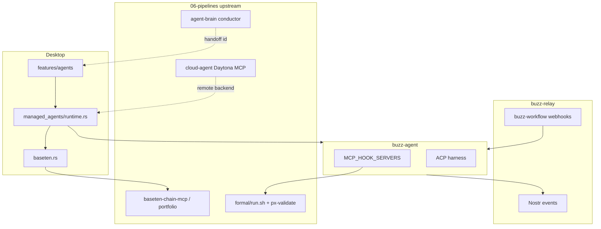

# Implementation Plan: Buzz Durable Agent Platform

**Branch**: `011-buzz-durable-agent-platform` | **Date**: 2026-09-08 | **Spec**: [spec.md](./spec.md)

**Input**: Buzz fork integration of upstream [010-durable-agent-platform](../../../06-pipelines/specs/010-durable-agent-platform/spec.md) onto desktop managed agents, `buzz-agent`, `buzz-workflow`, and MCP hooks.

## Summary

Phase 0 establishes spec, GSD, constitution Section X, contracts (stubs), test manifest, and gap tracking — **no production Rust/TypeScript changes**. Subsequent slices S01–S06 wire Buzz surfaces to upstream Think (Baseten/chain), Do (Daytona), Verify (MCP hooks + px-validate), and Durability (workflow + upstream Temporal handoff).

## Technical Context

**Language/Version**: Rust 1.75+ (buzz-agent, desktop Tauri), TypeScript/React 19 (desktop), YAML (`buzz-workflow`)

**Primary Dependencies**: Tauri 2, ACP harness, `buzz-agent`, MCP client in agent, evalexpr (`buzz-workflow`), upstream cloud-agent Mastra MCP, baseten-chain-mcp, px-validate MCP

**Storage**: Relay Postgres (`buzz-db`), workflow definitions as Nostr events, agent definitions in relay + local retention DB

**Testing**: `just ci`, `cargo test` (baseten.rs), `lib/agentConfigCore.test.mjs`, Playwright `desktop/tests/e2e/agents.spec.ts`, upstream `smoke-platform-loop.sh` (cross-repo)

**Target Platform**: Buzz desktop (Tauri), relay WebSocket, optional remote `buzz-backend-*` providers

**Constraints**: No rival harness tables in TS; hooks off by default; Phase 0 docs-only

## Constitution Check

| Principle | How Buzz 011 treats it |
|-----------|------------------------|
| Upstream IX (inherited) | Temporal-backed cross-repo flows; `validate_chain_spec` before chain spend; formal before writes |
| X.I Buzz Nostr-first | New platform state as events/kinds — not ad-hoc HTTP |
| X.II MCP hooks | `MCP_HOOK_SERVERS` allowlist; `_` prefix convention |
| X.III Baseten authority | `baseten.rs` only path for native Baseten → OpenAI-compat translation |
| X.IV Agent config | `desktop/src/features/agents/AGENTS.md` is law for UI/config |
| X.V Phase discipline | Phase 0 = docs; S01+ = implementation slices |

## Project Structure

```text
buzz/
├── specs/011-buzz-durable-agent-platform/
│   ├── spec.md
│   ├── plan.md
│   ├── tasks.md
│   ├── contracts/
│   │   ├── mcp-registry.md
│   │   ├── baseten-think.md
│   │   ├── daytona-do.md
│   │   ├── formal-gates.md
│   │   └── durability-handoff.md
│   └── checklists/requirements.md
├── .gsd/
│   ├── config.json
│   ├── STATE.md
│   ├── DECISIONS.md
│   ├── milestones/M-buzz-platform/
│   ├── evidence/
│   └── gaps/tracking.md
├── .specify/memory/constitution.md
├── ontology-flow/test-manifest.yaml
├── docs/MCP_DRIVEN_HOOKS.md
├── desktop/src/features/agents/
├── desktop/src-tauri/src/managed_agents/baseten.rs
├── crates/buzz-agent/
├── crates/buzz-workflow/
└── crates/buzz-acp/
```

## Buzz integration topology



## Phase → slice map

| Slice | Upstream | Buzz deliverable | Test column |
|-------|----------|------------------|-------------|
| S01 | US1 | Workflow + agent dispatch docs; config core alignment | `agentConfigCore.test.mjs` |
| S02 | US2 | `daytona-do.md` + remote backend run-location UX | `agents.spec.ts` (warning copy) |
| S03 | US3 | `baseten-think.md` + env contract with `baseten.rs` | `baseten.rs` unit tests |
| S04 | US4 | `formal-gates.md` + hook registry stub | MCP hook integration test (S04) |
| S05 | US5 | Temporal handoff doc; workflow retry policy | workflow schema tests |
| S06 | US6 | E2E evidence + manifest `covered` | cross-repo smoke + desktop E2E |

## S05 — Durability handoff (Temporal env passthrough)

**Contract:** [contracts/durability-handoff.md](./contracts/durability-handoff.md)  
**Upstream design:** [010 plan §PlatformConductorWorkflow](../../../06-pipelines/specs/010-durable-agent-platform/plan.md#platformconductorworkflow-design)

Buzz relay workflows handle **local** durability (run rows, schedule claims). Cross-repo platform durability is owned by **agent-brain** Temporal worker (010 T052 — not yet implemented).

### Temporal workflow id pattern

```
platform:{tenant}:{jobId}
```

| Segment | Source | Example |
|---------|--------|---------|
| `tenant` | Community id or operator slug | `acme-prod` |
| `jobId` | Stable platform job id (webhook `job_id`) | `job-20260908-abc` |

Task queues (v1, do not merge workers):

| Queue | Package | Workflow id prefix |
|-------|---------|-------------------|
| `agent-brain` | `06-pipelines/agent-brain/` | `platform:`, `brain:` |
| `baseten-chain` | `baseten-chain-mcp/` | `chain:` |

### Env passthrough (Buzz → agent session / operator tooling)

Set by webhook trigger context, workflow templates, or future Tauri spawn — **never commit secret values**.

| Variable | Set by | Required | Purpose |
|----------|--------|----------|---------|
| `BUZZ_PLATFORM_JOB_ID` | Webhook body / operator | Platform jobs | Stable job correlation; matches `trigger.body.job_id` |
| `BUZZ_PLATFORM_TENANT` | Relay community or body | Platform jobs | Tenant segment for Temporal id |
| `TEMPORAL_WORKFLOW_ID` | Conductor or operator | Optional (read-only) | Display/log correlation: `platform:{tenant}:{jobId}` |
| `TEMPORAL_ADDRESS` | agent-brain worker only | Upstream worker | Not injected into desktop spawn v1 |
| `TEMPORAL_NAMESPACE` | agent-brain worker only | Upstream worker | Not injected into desktop spawn v1 |
| `TEMPORAL_API_KEY` | agent-brain worker only | Upstream worker | Secrets stay on conductor worker |

Webhook JSON fields consumed by [platform-dispatch.workflow.yaml](./examples/platform-dispatch.workflow.yaml):

| Body field | Maps to |
|------------|---------|
| `job_id` | Template `{{trigger.body.job_id}}`, `BUZZ_PLATFORM_JOB_ID` |
| `tenant` | `BUZZ_PLATFORM_TENANT` (fallback: relay community id) |
| `conductor_url` | Optional `notify_upstream` step POST target |

### Buzz-workflow retry summary

- Failed step → run **Failed**; no in-run step retry (`finalize_run` in `buzz-workflow`).
- Cron/interval: `claim_scheduled_workflow_fire` prevents duplicate ticks across pods.
- Webhook: each POST → new run; platform idempotency relies on stable `job_id` + upstream Temporal start.

### S05 exit criteria

| Gate | Status (2026-09-08) |
|------|---------------------|
| Docs: `durability-handoff.md`, example YAML, this section | met |
| Tests: `cargo test -p buzz-workflow` | met (169 pass) |
| Wire: `platformConductorWorkflow.ts` (010 T052) | **blocked** — upstream open |
| Manifest `PRODUCT-B-temporal-handoff` | **open** until T052 |

## Environment contract (Buzz-relevant)

| Variable | Surface | Required for |
|----------|---------|--------------|
| `MCP_HOOK_SERVERS` | buzz-agent | Verify hooks (opt-in) |
| `BUZZ_AGENT_HOOK_TIMEOUT_MS` | buzz-agent | Hook timeout |
| `BUZZ_AGENT_STOP_MAX_REJECTIONS` | buzz-agent | Stop budget |
| `BASETEN_API_KEY`, `BASETEN_MODEL_ID`, `BASETEN_MODEL_APIS_BASE`, `BASETEN_PROXY_BASE_URL` | baseten.rs → buzz-agent | Think Path A (inference) |
| `BASETEN_CHAIN_PORTFOLIO_ID` | upstream baseten-chain-mcp, agent-brain | Think Path B (portfolio default `nwxlx5wy`) |
| `CHAIN_EXECUTION_SPEC` | upstream MCP / agent-brain | Think Path B — triggers governed chain submit |
| `BUZZ_AGENT_PROVIDER`, `OPENAI_COMPAT_*` | buzz-agent | Derived from Baseten |
| `DAYTONA_*`, `SANDBOX_PROVIDER` | remote Do (via upstream MCP) | Do stage |
| `BUZZ_PLATFORM_JOB_ID`, `BUZZ_PLATFORM_TENANT` | workflow webhook → agent spawn (design) | Platform job correlation |
| `TEMPORAL_WORKFLOW_ID` | operator / conductor callback | Read-only Temporal id display |
| `TEMPORAL_ADDRESS`, `TEMPORAL_NAMESPACE`, `TEMPORAL_API_KEY` | upstream agent-brain worker | Durability (not desktop v1) |

Never commit secret values. See upstream [cross-repo-map](../../../06-pipelines/specs/010-durable-agent-platform/docs/cross-repo-map.md).

## Product development channel (Welcome Team)

**Canonical Buzz channel:** `#product-development` (`28c8bf26-10fa-42e7-b658-38092562bfe1`) on `wss://pathx.communities.buzz.xyz`.

| Concern | Doc / artifact |
|---------|----------------|
| Channel purpose, backlog, CLI | [docs/product-development-channel.md](./docs/product-development-channel.md) |
| Unified agent ↔ chainlet registry | [`gpu-inference-stack/config/agent-chainlet-registry.yaml`](../../gpu-inference-stack/config/agent-chainlet-registry.yaml) |
| Welcome Team registry slice | [`gpu-inference-stack/config/welcome-team-chainlet-registry.yaml`](../../gpu-inference-stack/config/welcome-team-chainlet-registry.yaml) |
| Platform dev registry slice | [`gpu-inference-stack/config/platform-dev-agent-registry.yaml`](../../gpu-inference-stack/config/platform-dev-agent-registry.yaml) |
| Spawn env wiring | `desktop/src-tauri/src/managed_agents/chainlet_registry.rs` |
| Seed product thread | [docs/welcome-team-chainlet-product-conversation.md](./docs/welcome-team-chainlet-product-conversation.md) |

**Next wiring (S03/S05 product slice):**

1. **Spawn env** — Tauri `spawn_agent_child` reads welcome + platform-dev registries (by `persona_id`) and sets `BUZZ_AGENT_CHAIN_SPECIALTY` + optional `BUZZ_PLATFORM_*` from webhook context. **Done (T073).**
2. **Completion predicates** — upstream `PlatformConductorWorkflow` evaluates per-specialty rules in registry before wake (semantic partial → retry or `needs_human`).
3. **E2E** — platform dispatch workflow @mentions agent in `#product-development`; evidence cites chain output + job id.

Agents Fizz / Honey / Pollen discuss product decisions in this channel; Path A chat stays Constitution-compliant; Path B chain jobs never originate from desktop HTTP.

## Cross-repo dependencies

| Artifact | Path from buzz root |
|----------|---------------------|
| Upstream 010 spec | `../../06-pipelines/specs/010-durable-agent-platform/` |
| cloud-agent Daytona MCP | `../cloud-agent/src/mastra/tools/daytona-tools.ts` |
| baseten-chain-mcp | `../../baseten-chain-mcp/` |
| gpu-inference-stack chain IDs | `../gpu-inference-stack/config/baseten-chain-ids.json` |
| Welcome Team chainlet registry | `../gpu-inference-stack/config/welcome-team-chainlet-registry.yaml` |
| Platform dev chainlet registry | `../gpu-inference-stack/config/platform-dev-agent-registry.yaml` |
| Unified chainlet registry | `../gpu-inference-stack/config/agent-chainlet-registry.yaml` |
| px-validate formal | `../../../../Brightforest/projects/tools/px-validate/formal/` |
| agent-brain conductor | `../../06-pipelines/agent-brain/` |

## Phasing (GSD M-buzz-platform)

| Slice | Status (Phase 0) |
|-------|------------------|
| S01 Agent dispatch docs | scaffolded |
| S02 Daytona Do contract | stub |
| S03 Baseten Think contract | stub |
| S04 Formal gates + hooks | stub |
| S05 Durability handoff | **docs gate met** — wire blocked on upstream T052 |
| S06 E2E evidence | **docs gate met** — PRODUCT manifest open |
